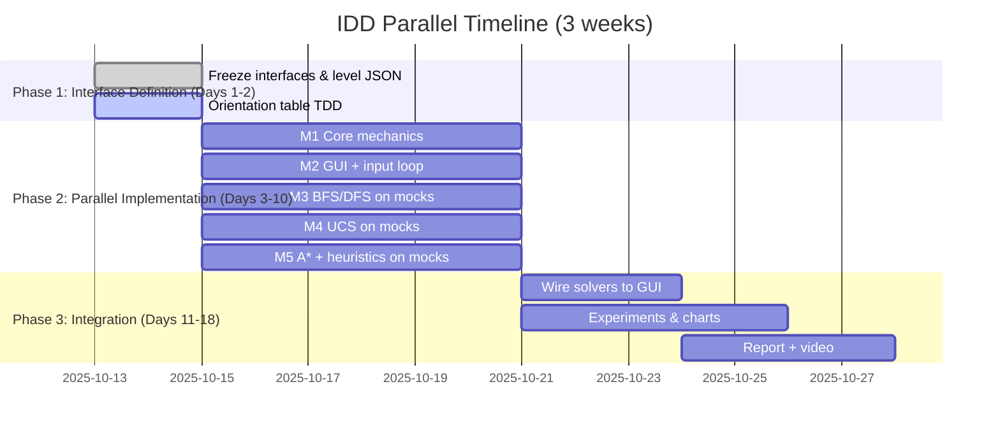

# Bloxorz Solver — Interface-Driven Development & Parallel Engineering Plan

> **Course:** CSC14003 — Introduction to Artificial Intelligence — Project 1: Bloxorz Solver  
> **Stack:** Python + Pygame-CE | Team: 5 members | Duration: ~3 weeks  
> **Source:** `AI - Project 1.pdf` (8 pages, Faculty of Information Technology, VNU-HCM)  
> **Goal:** Replace flawed Waterfall (M1-2 blocked until Oct 18 → M3-5 idle) with IDD + Mock-Driven parallel workflow.

---

## Table of Contents

1. [Why Waterfall Fails Here](#1-why-waterfall-fails-here)
2. [Data Contracts (Interfaces) — Freeze Day 1](#2-data-contracts-interfaces--freeze-day-1)
3. [Mock-Driven Parallel Execution](#3-mock-driven-parallel-execution)
4. [Phase-by-Phase Task Matrix](#4-phase-by-phase-task-matrix)
5. [Version Control & CI/CD Strategy](#5-version-control--cicd-strategy)

---

## 1. Why Waterfall Fails Here

| Waterfall (current) | Problem |
|---|---|
| M1 & M2: GUI + Core Logic → due Oct 18 | Blocks all downstream work |
| M3, M4, M5: BFS/DFS, UCS, A* → start Oct 18, due Oct 23 | 5 days idle, 5 days to implement + profile + integrate 4 algorithms |
| Integration: Oct 23 | No buffer for `bridge_mask` bugs, heuristic admissibility fixes, or GUI wiring |

**IDD fix:** Freeze `game_state` + `get_successors()` + `SolverResult` signatures on **Day 1**. All 5 members code against the contract, not against each other's implementation. Integration becomes wiring, not rewriting.



---

## 2. Data Contracts (Interfaces) — Freeze Day 1

> **File:** `core/interfaces.py` (or `core/game_state.py` + `core/board.py` — agree on one path Day 1, never rename without PR).  
> **Rule:** No member imports `pygame` in `core/` or `solvers/`. GUI depends on core, never the reverse.

### 2.1 State Representation

The PDF (§2.2, §2.5) mandates: orientation is part of state, and **bridge open/closed status is part of state identity** — same block position with different bridge configs = different states.

```python
from dataclasses import dataclass
from enum import Enum

class Orientation(Enum):
    STANDING = 0   # occupies single cell (r, c)
    LYING_H = 1    # occupies (r, c) and (r, c+1)
    LYING_V = 2    # occupies (r, c) and (r+1, c)

class TileType(Enum):
    VOID = 0
    FLOOR = 1
    GOAL = 2
    FRAGILE = 3    # orange — only supports lying block
    BRIDGE = 4     # passability controlled by switches

@dataclass(frozen=True)
class BlockState:
    r: int
    c: int  # anchor: standing cell OR top/left of lying block
    orientation: Orientation
    # Split extension (PDF §2.5):
    is_split: bool = False
    cube_positions: tuple[tuple[int, int], tuple[int, int]] | None = None
    active_cube: int = 0  # 0 or 1, toggled by SPACE

@dataclass(frozen=True)
class GameState:
    block: BlockState
    bridge_mask: int  # bitmask: bit i = 1 → bridge i open, 0 → closed
    # Makes GameState hashable for visited set; do NOT store mutable dict here

    def occupied_cells(self) -> list[tuple[int, int]]:
        ...

@dataclass
class Switch:
    id: str
    type: str  # "soft" | "heavy" | "split"
    position: tuple[int, int]
    bridge_ids: list[str]
    mode: str  # "toggle" | "permanent"
    # soft: any part presses; heavy/split: only standing triggers (PDF §2.5)

@dataclass
class Level:
    width: int
    height: int
    tiles: dict[tuple[int, int], TileType]
    goal: tuple[int, int]
    start: BlockState
    bridges: dict[str, list[tuple[int, int]]]  # id → tiles
    switches: list[Switch]
    split_rules: dict  # control_switch_key, merge_when_adjacent, etc.
```

**Why `bridge_mask: int` and not `dict`?** Hashable, fast `visited` lookup, and forces a single source of truth for bridge state. Map `bridge_id → bit index` once at level load.

**Level format:** Reuse `levels/level_01.json` already in repo (canonical example). All levels share this JSON schema so solvers and GUI load the same file:

```json
{
  "id": "level_01",
  "width": 8, "height": 7,
  "start": { "position": [1, 3], "orientation": "standing" },
  "goal": [6, 3],
  "tiles": [[1,3], [2,3]],
  "fragile_tiles": [[3,2]],
  "bridges": [{ "id": "north_bridge", "tiles": [[4,1]], "initial_state": "closed" }],
  "switches": [{ "id": "soft_toggle", "type": "soft", "position": [2,2], "effect": { "bridge_ids": ["north_bridge"], "mode": "toggle" } }]
}
```

### 2.2 Core Transition API

```python
def get_successors(state: GameState, level: Level) -> list[tuple[str, GameState, float]]:
    """
    Returns [(action, next_state, step_cost)] for legal moves.
    Actions: "U", "D", "L", "R", "SPACE" (switch active cube when split).
    - Applies orientation transition table (see §2.3).
    - Checks is_legal() — any occupied cell on VOID/closed BRIDGE → illegal.
    - Standing on FRAGILE → illegal (PDF §2.5).
    - Triggers switches → flips bridge_mask bits (toggle/permanent).
    - Split switch (standing only) → returns split GameState with two cubes.
    """

def is_goal(state: GameState, level: Level) -> bool:
    """True iff block STANDING on goal AND not split (single cube cannot win, PDF §2.5)."""

def is_legal(state: GameState, level: Level) -> bool:
    """All occupied cells on FLOOR/GOAL/open BRIDGE; standing on FRAGILE → False."""

def apply_move(state: GameState, action: str, level: Level) -> GameState | None:
    """Deterministic single-step transition; returns None if illegal."""
```

### 2.3 Orientation Transition Table (TDD Day 1)

PDF hint: *"Pay close attention to the orientation transition table: each (orientation, direction) pair maps deterministically."* Unit-test this table before any other logic.

| From | U (r-1) | D (r+1) | L (c-1) | R (c+1) |
|------|---------|---------|---------|---------|
| **STANDING** at (r,c) | LYING_V at (r-2,c) | LYING_V at (r+1,c) | LYING_H at (r,c-2) | LYING_H at (r,c+1) |
| **LYING_H** at (r,c) | LYING_H at (r-1,c) | LYING_H at (r+1,c) | STANDING at (r,c-1) | STANDING at (r,c+2) |
| **LYING_V** at (r,c) | STANDING at (r-1,c) | STANDING at (r+2,c) | LYING_V at (r,c-1) | LYING_V at (r,c+1) |

Split cubes: each cube moves as a 1×1 point (4-neighbor), `SPACE` toggles `active_cube`.

### 2.4 Solver Contract

All 4 algorithms implement the same interface so GUI can call them interchangeably and experiments can compare metrics fairly (PDF §3.6 requires fixed test set, 4 metrics per solver).

```python
from dataclasses import dataclass

@dataclass
class SolverResult:
    path: list[str] | None       # e.g. ["R","R","U","SPACE"] or None if unsolvable
    expanded_nodes: int          # number of states dequeued/expanded
    search_time_ms: float        # wall-clock via time.perf_counter()
    peak_memory_kb: int          # via tracemalloc.get_traced_memory()[1]
    solution_length: int         # len(path) or -1 if None
    cost: float                  # sum of step_costs
    success: bool                # path is not None

class Solver:
    """All solvers implement this. No pygame import allowed."""
    def solve(self, level: Level, start: GameState) -> SolverResult: ...
    def heuristic(self, state: GameState, level: Level) -> float: ...  # 0 for BFS/DFS/UCS
```

**Cost function (UCS/A*):**

- Default: $cost(s, a, s') = 1$ per roll (then UCS ≡ BFS — PDF says design non-uniform cost to make UCS meaningful).
- Recommended non-uniform (justify in report): fragile entry $cost=2$ (risky), switch toggle $cost=0.5$ (cheap), normal $cost=1$.

**Heuristic for A* (must be admissible w.r.t. chosen cost):**

For unit cost, admissible heuristic:

$$h(s) = \frac{|r - r_g| + |c - c_g|}{2} + \begin{cases}0 & \text{if standing} \\ 0.5 & \text{otherwise}\end{cases}$$

- Manhattan distance divided by 2: one roll moves at most 2 cells.
- Orientation penalty: non-standing needs ≥1 extra roll to stand on goal.
- Alternative (PDF suggestion): relaxed point-object BFS distance ignoring voids/fragile — also admissible lower bound.

> **Report requirement (§3.5):** Prove admissibility ($h(s) \leq h^*(s)$) and discuss consistency ($h(s) \leq cost(s,a,s') + h(s')$) relative to your cost function.

---

## 3. Mock-Driven Parallel Execution

**Goal:** M3, M4, M5 start **today**, decoupled from Pygame loop and from `core/movement.py` completion.

### 3.1 How It Works

```
core/interfaces.py  ← frozen Day 1 (GameState, Level, SolverResult, get_successors sig)
        │
        ├──→ core/movement.py (M1) ──→ real get_successors()
        │
        └──→ tests/mocks.py ──→ mock_level_*() + stub get_successors()
                        │
                        ├──→ solvers/BFS.py (M3) ─┐
                        ├──→ solvers/UCS.py (M4) ─┤── all import ONLY interfaces + mocks
                        └──→ solvers/astar.py (M5)┘     no pygame, no core internals
```

**Swap is one line:** `from tests.mocks import get_successors` → `from core.movement import get_successors`. Zero solver logic change.

### 3.2 Mock Data to Create Day 1

Create `tests/mocks.py` (no `pygame` import):

```python
# tests/mocks.py
from core.interfaces import GameState, BlockState, Orientation, Level, TileType

def mock_level_simple() -> Level:
    """3×7 corridor, no advanced tiles — for BFS/DFS correctness."""
    ...

def mock_level_with_fragile() -> Level:
    """Corridor + one FRAGILE tile — tests is_legal() standing vs lying."""
    ...

def mock_level_with_bridge() -> Level:
    """Closed bridge + soft switch — tests bridge_mask in state identity."""
    ...

def mock_level_split() -> Level:
    """Split switch + two cubes — tests SPACE toggle and merge."""
    ...

def stub_successors(state: GameState, level: Level):
    """Optional deterministic stub returning 2-4 successors for early profiling
    without waiting for core/movement.py. Replace with real get_successors when ready."""
    ...
```

Create `tests/test_solvers_mock.py`:

```python
def test_bfs_finds_shortest_path_on_mock():
    level = mock_level_simple()
    result = BFSSolver().solve(level, level.start)
    assert result.success and result.solution_length == 5

def test_visited_avoids_cycles():
    ...

def test_metrics_collected():
    result = BFSSolver().solve(mock_level_simple(), ...)
    assert result.expanded_nodes > 0 and result.search_time_ms > 0
```

### 3.3 What Each AI Member Does in Parallel

| Member | Algorithm | Mock workflow (Days 3-10) | Profiling from Day 3 |
|--------|-----------|---------------------------|----------------------|
| **M3** | BFS + DFS/IDS | Implement queue/stack + `visited: set[GameState]`, handle cycles (PDF §3.3) | `expanded_nodes`, `search_time_ms`, `peak_memory_kb` via `tracemalloc` |
| **M4** | UCS | Priority queue (`heapq`), cost function design + justification | Compare uniform vs non-uniform cost; verify UCS ≡ BFS when cost=1 |
| **M5** | A* | Implement `heuristic()` + admissibility proof, test 2 heuristics | Compare $h_1$ (Manhattan/2) vs $h_2$ (relaxed BFS) on same mock levels |

All three run `pytest tests/test_solvers_mock.py -v` and benchmark on 4 difficulty groups (PDF §3.6: simple → fragile → switches → combined) **before** core is done.

### 3.4 Metrics Harness (shared in `solvers/common.py`)

```python
import time, tracemalloc

def run_solver(solver: Solver, level: Level, start: GameState) -> SolverResult:
    tracemalloc.start()
    t0 = time.perf_counter()
    result = solver.solve(level, start)
    dt = (time.perf_counter() - t0) * 1000
    _, peak = tracemalloc.get_traced_memory()
    tracemalloc.stop()
    result.search_time_ms = dt
    result.peak_memory_kb = peak // 1024
    return result
```

GUI (M2) later calls the same `run_solver()` and animates `result.path` — no solver code change.

---

## 4. Phase-by-Phase Task Matrix

### Phase 1: Interface Definition (Days 1–2) — All 5 Members

> **Exit criteria:** `core/interfaces.py` merged to `develop`, `levels/level_01.json` schema frozen, orientation table tests green.

| Member | Tasks | Deliverable |
|--------|-------|-------------|
| **M1** | Co-own `core/interfaces.py`, define `TileType`, `BlockState`, `GameState`, `bridge_mask` semantics | `core/interfaces.py` PR |
| **M2** | Co-own interfaces, define GUI→solver callback `on_solve(algo: str) -> SolverResult` and animation contract (`path: list[str]` → frame sequence) | `ui/solver_bridge.py` stub |
| **M3** | Co-own `SolverResult` + `Solver` ABC, define BFS/DFS metrics harness | `solvers/common.py` |
| **M4** | Co-own cost function spec for UCS, draft non-uniform cost justification | `docs/cost-function.md` |
| **M5** | Co-own heuristic spec for A*, draft admissibility proof outline | `docs/heuristic.md` |

**Ceremony:** 2-hour interface workshop Day 1, then PR review by all 5 before merge. Any change to `core/interfaces.py` after Day 2 requires 2 approvals (CODEOWNERS).

### Phase 2: Parallel Implementation (Days 3–10) — No Blocking

| Member | Owns | Works Against | Daily CI |
|--------|------|---------------|----------|
| **M1 — Core Mechanics** | `core/board.py`, `core/movement.py`, `core/game_rules.py` (fragile, bridges, 3 switch types, split/rejoin), `levels/level_loader.py` | `core/interfaces.py` + orientation table tests | `pytest tests/test_movement.py` |
| **M2 — GUI & Loop** | `rendering/`, `ui/` (Pygame-CE main loop, board rendering with tile colors, block rendering per orientation, buttons: New Game / Restart / Solve BFS/DFS/UCS/A*, metrics overlay) | `core/interfaces.py` + `tests/mocks.py` (renders mock levels) | `pytest tests/test_gui_smoke.py` (no display needed — mock surface) |
| **M3 — BFS/DFS** | `solvers/BFS.py`, `solvers/DFS.py` (or IDS), `visited` hashing, cycle avoidance | `tests/mocks.py` | `pytest tests/test_solvers_mock.py -k bfs` |
| **M4 — UCS** | `solvers/UCS.py`, cost function impl, priority queue | `tests/mocks.py` | `pytest tests/test_solvers_mock.py -k ucs` |
| **M5 — A*** | `solvers/astar.py`, 2 heuristics, admissibility/consistency analysis | `tests/mocks.py` | `pytest tests/test_solvers_mock.py -k astar` |

**Key rule:** `solvers/` never imports `pygame` or `rendering/`. `core/` never imports `solvers/` or `ui/`. Enforce via `ruff` import-linter or simple `grep` in CI.

### Phase 3: Final Integration (Days 11–18)

| Day | Activity | Owner | Output |
|-----|----------|-------|--------|
| 11–12 | Wire real `get_successors` into solvers (one-line swap), fix `bridge_mask` bugs | M1 + M3/M4/M5 | All solvers green on real `level_01.json` |
| 11–13 | Wire `SolverResult.path` → GUI animation (replay moves with delay), metrics overlay | M2 + M3/M4/M5 | Demo-able GUI |
| 13–15 | Experiments on fixed test set (4 difficulty groups × 4 solvers × 4 metrics) | M3, M4, M5 | `experiments/results.csv` + `matplotlib` charts |
| 15–17 | Report: Algorithm Description + Experiments + Planning/Distribution | M5 (lead) + all | `Report.pdf` |
| 17–18 | Video: GUI demo + manual play + solver replay with narration | M2 (lead) + all | YouTube link |

**Buffer:** Days 16–18 are buffer for oral interview prep (PDF §5: instructors may interview random groups).

---

## 5. Version Control & CI/CD Strategy

> **Note:** No workflow YAML is committed at this stage per request — this section describes the branching and pipeline design to adopt when CI is enabled.

### 5.1 Branching Strategy (GitHub Flow variant)

```
main  (protected, tagged releases, e.g. v0.1.0, v1.0.0)
  ↑
develop  (integration branch, always green)
  ├── feature/core-mechanics      (M1)
  ├── feature/gui-loop            (M2)
  ├── feature/solver-bfs-dfs      (M3)
  ├── feature/solver-ucs          (M4)
  └── feature/solver-astar        (M5)
```

**Rules:**

- `main` and `develop` are protected — no direct pushes, PR + 1 review + CI green required.
- Feature branches branch from `develop`, PR back to `develop` daily (small PRs, <200 lines).
- `core/interfaces.py` is `CODEOWNERS` = all 5 members — changes need 2 approvals.
- Use `git merge --no-ff` for feature integration to preserve history (needed for report's contribution percentages, PDF §3.6).
- Tag releases: `v0.1-interfaces`, `v0.5-parallel`, `v1.0-submission`.

**Commit convention:** `feat(core): add bridge_mask to GameState`, `feat(solvers): implement UCS with heapq`, `test(mocks): add fragile level`.

### 5.2 CI Pipeline Design (to enable when ready)

When CI is enabled, the pipeline should run on every `push` and `pull_request` to `develop`/`main`:

| Job | Steps | Purpose |
|-----|-------|---------|
| **test** | `setup-python 3.11` → `pip install -r requirements.txt` → `pytest tests/ -q` → `python -m py_compile core/*.py solvers/*.py` | Solvers pass on mocks before core exists; real levels after integration |
| **lint** | `ruff check .` + `ruff format --check .` | Enforce no `pygame` in `core/`/`solvers/`, import hygiene |
| **typecheck** (optional) | `mypy core/ solvers/` | Catch `GameState` hashability / `bridge_mask` type errors early |

**Why this matters now (even without workflow file):**

- M3-M5 CI passes from Day 3 via mocks — proves solvers work before core lands.
- Daily PRs to `develop` catch `bridge_mask` missing-from-state bugs early (PDF warns: *"states with same block but different bridge configs are different states"*).
- `pytest` with fixed test set ensures fair comparison for report experiments (PDF §3.6).

### 5.3 Local CI Before Push (until workflow is added)

Each member runs before pushing:

```python
# Windows (PowerShell)
pip install -r requirements.txt
pytest tests/ -q
python -m py_compile core/*.py solvers/*.py levels/*.py
```

### 5.4 Merge Safety for AI Algorithms

- **No solver touches `core/` or `ui/`** — merge conflicts are structurally impossible if contracts are respected.
- **Solver PRs only touch `solvers/<algo>.py` + `tests/test_solvers_mock.py`** — parallel merges are conflict-free.
- **Integration PR** (`develop` → `main`) is the only PR that touches `core/` + `solvers/` + `ui/` together — review by all 5.

---

## Appendix: File Map

```
project_01_bloxz/
├── core/
│   ├── interfaces.py      # ← freeze Day 1 (this plan's §2)
│   ├── board.py           # M1
│   ├── movement.py        # M1 (orientation table)
│   └── game_rules.py      # M1 (fragile/bridges/switches/split)
├── levels/
│   ├── level_01.json      # canonical, already in repo
│   └── level_loader.py    # M1
├── solvers/
│   ├── common.py          # M3 (Solver ABC + metrics harness)
│   ├── BFS.py             # M3
│   ├── DFS.py             # M3
│   ├── UCS.py             # M4
│   └── astar.py           # M5
├── tests/
│   ├── mocks.py           # ← create Day 1 (this plan's §3.2)
│   ├── test_movement.py   # M1
│   └── test_solvers_mock.py # M3/M4/M5
├── rendering/             # M2
├── ui/                    # M2
├── docs/
│   └── parallel-engineering-plan.md  # this file
├── main.py
└── requirements.txt       # pygame>=2.5.0, pytest>=8.0.0
```

---

*This plan implements Interface-Driven Development to eliminate the Oct 18 bottleneck: AI team delivers profiled solvers by Oct 18 in parallel, integration becomes a 2-day wiring task with buffer for experiments, report, and video.*
